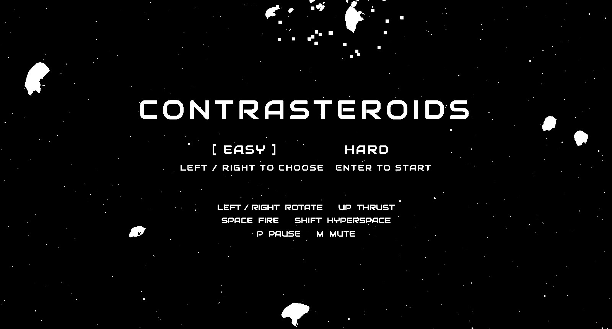

<p align="center"><a href="https://dgrlabs.co/contrasteroids/"></a></p>

# Contrasteroids

A rock-shooting arcade game in hard black and white. Play it at [dgrlabs.co/contrasteroids](https://dgrlabs.co/contrasteroids/).

Space has no air to scatter light, so anything the light doesn't hit directly is black. The game is built on that idea. The rocks are solid 3D models with no fill light and hard-edged shadows, so you read a rock's shape from where its lit face ends and from the shadows its craters cast.

There are two ways to play. In Easy, one sun off the edge of the screen lights everything, and every pixel is either black or white. In Hard there is no sun. Your ship carries a spotlight on its nose and a faint glow around it, your shots light up whatever they pass, and the alien ships glow too. Light fades to grey and then black with distance. A rock outside the beam shows up only as a gap in the stars.

Shoot the rocks and they split into smaller ones. Rocks that collide with each other split too. Three kinds of alien ships show up as the waves go on. One crosses the screen firing at you, one lays mines, and one hunts you down and rams you.

## Controls

On a keyboard:

| Key | Action |
| --- | --- |
| ← → or A D | Rotate |
| ↑ or W | Thrust |
| Space | Fire |
| Shift, ↓, or S | Hyperspace |
| ← → or A D (title screen) | Choose Easy or Hard |
| Enter | Start |
| P | Pause |
| M | Sound on or off |

On a phone or tablet, buttons appear on screen. Your left thumb rotates and your right thumb thrusts and fires. H jumps to hyperspace. Tap the left half of the title screen to start in Easy, or the right half for Hard. Tap again to carry on after a pause. The screen is roomier if you hold the phone sideways.

## Scoring

Large rocks are worth 20 points, medium rocks 50, and small rocks 100. A mine is worth 50. The aliens are worth 200, 500, and 1,000 in the order they appear. You get an extra ship every 10,000 points, and the browser keeps a high score for each mode.

## How it's made

It's three.js and Vite, with no image or audio files. Easy renders with a single directional light and shadow maps, and a final shader pass turns every lit pixel white and everything else black. Hard swaps the sun for a shadow-casting spotlight and small point lights on the ships and shots, and lets distance show as grey. In both, a surface either faces a light or it doesn't, which keeps the edges sharp. The text is set in Audiowide. The rocks are generated as the game runs, so no two look alike. Every sound is synthesized with the Web Audio API, including a low drone that tightens as you clear each wave.

## Running it

```
npm install
npm run dev
```

`npm run build` writes a static copy to `dist/` with relative paths, so it can be hosted from any folder. `npm run publish:site` builds it and copies it into a sibling `dgrlabs_co` checkout at `contrasteroids/`.

## License

MIT. See [LICENSE](LICENSE).
